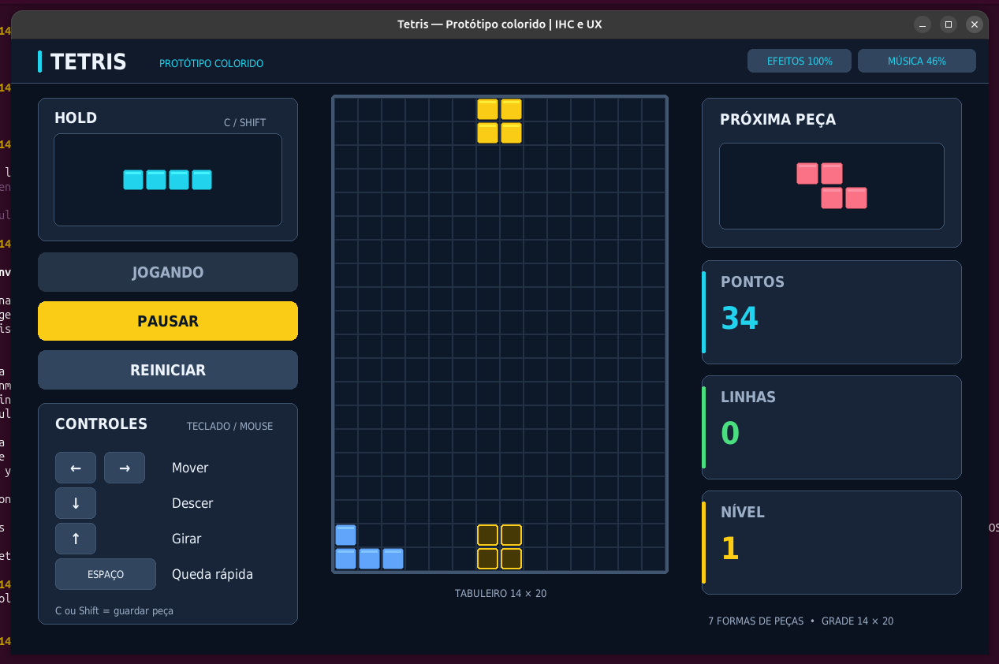

# Tetris — protótipo para aulas de IHC e UX

Jogo de Tetris em Python com Pygame, desenvolvido como protótipo didático para aulas de Interação Humano-Computador (IHC) e Experiência do Usuário (UX). Inclui interface colorida, controles por teclado e mouse, efeitos sonoros e trilha chiptune sintetizados pelo próprio programa.



## Requisitos

- Python 3.10 ou superior.
- Pygame Community Edition (`pygame-ce`, importado no código como `pygame`).
- Ambiente gráfico para abrir a janela do jogo.
- Dispositivo de áudio opcional: o código prevê funcionamento sem áudio quando o mixer não estiver disponível.

## Instalação

Abra um terminal na pasta do projeto e crie um ambiente virtual:

```bash
python -m venv .venv
```

Ative o ambiente conforme seu sistema:

**Linux ou macOS:**

```bash
source .venv/bin/activate
```

**Windows — PowerShell:**

```powershell
.venv\Scripts\Activate.ps1
```

Com o ambiente ativado, instale a dependência:

```bash
python -m pip install pygame-ce
```

Se o comando `python` não estiver disponível no Linux ou macOS, use `python3` para criar o ambiente virtual. No Windows, você também pode usar `py -3` nessa etapa.

## Execução

Na pasta do projeto, com o ambiente virtual ativado:

```bash
python tetris.py
```

A janela abre na tela inicial. Pressione **Enter** ou clique em **INICIAR** para começar. Para encerrar, feche a janela.

## Controles

| Tecla | Ação |
|---|---|
| ← / → | Move a peça para a esquerda ou direita. |
| ↓ | Desce a peça manualmente. |
| ↑ | Gira a peça no sentido horário. |
| Espaço | Executa a queda rápida e fixa a peça. |
| C / Shift esquerdo ou direito | Guarda ou troca a peça no HOLD. |
| Enter | Inicia uma partida na tela inicial ou após o fim de jogo; retoma uma partida pausada. |
| P / Esc | Pausa ou retoma a partida. |
| R | Reinicia imediatamente a partida, zerando pontos, linhas e nível. |
| M | Liga ou desliga os efeitos sonoros. |
| N | Liga ou desliga a música. |
| + / - | Aumenta ou diminui o volume da música. |
| [ / ] | Diminui ou aumenta o volume dos efeitos. |

Manter ←, → ou ↓ pressionada repete o movimento. As demais ações dependem de um novo acionamento.

### Mouse

- Os botões **INICIAR**, **PAUSAR/RETOMAR** e **REINICIAR** controlam a partida.
- Clicar na área **HOLD** guarda ou troca a peça.
- Os botões de setas e **ESPAÇO** no painel de controles executam uma ação por clique.
- Os botões **EFEITOS** e **MÚSICA** no cabeçalho ligam ou desligam cada tipo de áudio.
- A roda do mouse ajusta o volume quando o ponteiro está sobre o respectivo botão de áudio.

## Regras e pontuação

O tabuleiro tem **14 colunas e 20 linhas**, com sete tipos de tetraminós: I, O, T, S, Z, J e L. A distribuição usa o sistema **7-bag**: cada grupo de sete contém uma peça de cada tipo, em ordem embaralhada.

Complete linhas horizontais para eliminá-las. A peça fantasma indica onde a peça atual cairá com a queda rápida, e o painel lateral mostra a próxima peça. O HOLD permite guardar ou trocar uma peça uma vez por peça em jogo; uma nova troca fica disponível após a fixação.

| Linhas eliminadas de uma vez | Pontos |
|---|---|
| 1 | 100 × nível atual |
| 2 | 300 × nível atual |
| 3 | 500 × nível atual |
| 4 | 800 × nível atual |

A descida manual rende **1 ponto por célula**; a queda rápida rende **2 pontos por célula**. A partida começa no nível 1 e sobe um nível a cada dez linhas acumuladas, aumentando a velocidade de queda. A pontuação das linhas usa o nível anterior à atualização causada por essa eliminação.

A partida termina quando uma nova peça não cabe na posição inicial ou quando uma peça é fixada com células acima do topo do tabuleiro. Não há atraso de fixação após uma tentativa de descida bloqueada. A rotação tenta pequenos deslocamentos perto de obstáculos; o código não implementa as tabelas de rotação SRS completas.

## Interface e áudio

A interface usa uma superfície lógica de **1120 × 940 pixels**, com células de 40 pixels e painéis laterais compactos de 232 pixels de largura. A janela pode ser redimensionada; o desenho preserva a proporção, com faixas nas bordas quando necessário. A tela inicial apresenta um tabuleiro ilustrativo que não faz parte da partida.

Os efeitos são gerados em memória. A trilha tem melodia, baixo, arpejo e bateria, com 16 compassos; começa em 128 BPM e acelera com o nível até 168 BPM. Música e efeitos têm controles independentes de volume. Ao pausar a partida, a trilha também é pausada.

O arquivo `tetris_trilha_original.wav` é uma prévia opcional. O programa não carrega esse arquivo para tocar a música e não precisa dele para executar.

## Estrutura do projeto

```text
tetris/
├── README.md                     # Documentação principal
├── tetris.py                      # Código do jogo, interface e áudio
├── tetris_trilha_original.wav     # Prévia opcional da trilha
└── .motor-IA/links/referencias.md  # Índice documental
```

O código está em um único arquivo, organizado em quatro classes principais:

| Classe | Responsabilidade |
|---|---|
| `Tetris` | Estado da partida, colisões, rotação, HOLD, filas, linhas e pontuação. |
| `Interface` | Desenho, redimensionamento, teclado, mouse e laço principal. |
| `AudioRetro` | Síntese e reprodução dos efeitos sonoros. |
| `TrilhaChiptune` | Síntese dos instrumentos e sequenciamento da música. |

A classe de dados `Peca` representa uma peça, e a função `celulas_peca` calcula suas células por rotação. O motor comunica eventos à interface por uma função de callback.

## Limitações e verificação

A implementação não salva recordes, partidas ou preferências entre execuções. A pasta não contém suíte de testes automatizados nem arquivo de dependências com versões fixadas.

Este README foi conferido por leitura do código. Essa conferência não constitui teste de jogabilidade, validação visual da interface ou avaliação auditiva da trilha.

## Referências

**Este documento referencia:**

- [[tetris.py]] — implementação usada como fonte desta documentação.
- [[tetris_trilha_original.wav]] — prévia opcional da trilha.

**Este documento é referenciado por:**

- [[referencias]] — índice de artefatos do projeto.
